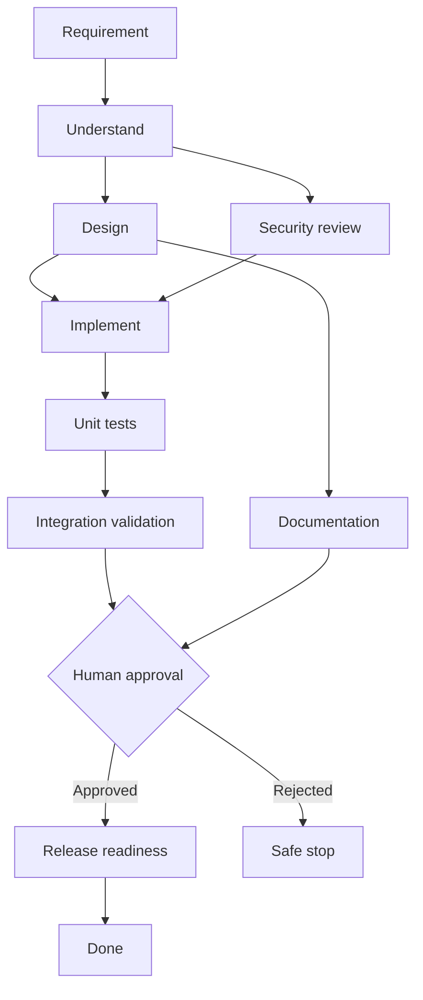

# Architecture and governance

Components: Spring MVC controllers → service layer → JdbcTemplate/H2. URL data: `urls`, `clicks`. Agentic workflow data: `workflows`, `tasks`, `approvals`, `audits`. Spring transactions bound each orchestration operation. Every workflow maintains a version, durable states and an append-only audit log.

- **Dependency graph:** `design` and `security_review` can become ready concurrently; `implement` joins both. `docs` and test chain are separate branches, joined at `human_approval`.
- **Entry/exit gates:** a node executes only when every predecessor is DONE. `human_approval` blocks and records reviewer, reason, decision. No automatic deployment.
- **Stateful re-planning:** changing upstream requirement increments version; invalidates all simulated generated task results and previous approval but preserves old audit events.
- **Failure controls:** explicit failure injection safe-stops workflow; failed tasks have max two attempts, a manual retry endpoint and rollback/safe-stop endpoint. State rollback is simulated rather than compensating actual deployments.
- **Policy boundary:** URL scheme validation; admin-key guard on workflow, analytics and deletion; no arbitrary code execution, no production deploy token.
- **Observability:** persistent audit events and aggregate workflow/retry/rollback/failure counts. End-to-end latency and MTTR are **not calculated** by this prototype; timestamps enable future instrumentation.
- **Isolation:** H2 is sufficient for interview demo; replace with PostgreSQL, unique job claiming and optimistic locking for multiple concurrently running nodes/workers.
